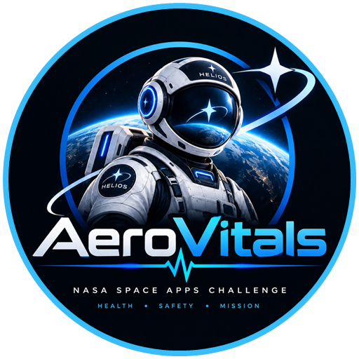

# H.E.L.I.O.S. - Credits, Citations & Attributions
### Official Project Credentials & Open Science Attribution Index
**NASA International Space Apps Challenge 2026**  
**Challenge Track:** Create Health Monitoring Software for Astronauts on Space Missions  
**Project:** H.E.L.I.O.S. (Health Evaluation & Longevity Intelligence for Orbiting Specialists / Deep-Space Sentry)

---

##  1. Team Aero Vitals - Core Contributors

| Contributor | Operational Role | Key Responsibilities & Contributions |
|:---|:---|:---|
| **Raisul Islam** | **Team Leader & Product Strategist** | Project coordination, challenge alignment, mission concept strategy, NASA Space Apps submission governance, and visual pitch production. |
| **Mohammad Zihaduzzaman** | **Lead Full-Stack Developer** | React 19 / TypeScript architecture, 10 Hz WebSocket streaming pipeline, state synchronization, interactive UI/UX, and component engineering. |
| **Mohammed Meraj** | **Lead Systems Architect & Security Engineer** | Aerospace system architecture, FastAPI core, OWASP defense-in-depth security, CSP/CORS lockdown, 3D WebGL engine calibration, and cloud deployment. |
| **Ashfia Tasnim** | **Biomedical & Life Sciences Researcher** | NASA OSDR biological dataset curation (SOMA Inspiration4), spaceflight health logic, physiological risk scoring (SANS/ARS), and biomarker mapping. |
| **Mohammad Sabbir** | **Video Producer & Media Editor** | Competition pitch video cinematography, 3D visual choreography, audio synchronization, motion graphics, and presentation assets. |

---

##  2. Official NASA Standards & Regulatory Frameworks

HELIOS is built in compliance with official National Aeronautics and Space Administration (NASA) flight standards:

1. **NASA-STD-3001, Vol 1 (Rev B)**: *NASA Space Flight Human-System Standard: Crew Health*
   - Standards for continuous vital sign monitoring, physiological reserves, and health support levels for exploration missions.
2. **NASA-STD-3001, Vol 2 (Rev D)**: *NASA Space Flight Human-System Standard: Human Factors, Habitability, and Environmental Health*
   - Environmental control thresholds: Cabin total pressure ($101.3\text{ kPa}$), partial pressure of carbon dioxide ($P\text{CO}_2 < 3.0\text{ mmHg}$), oxygen fraction ($20.9\% \pm 1.0\%$), and cabin acoustic/thermal limits.
3. **NASA-STD-8739.8**: *Software Assurance and Software Safety Standard*
   - Deterministic offline execution, graceful degradation, sub-second exception recovery, and strict boundary input sanitization.
4. **NASA Human Research Program (HRP) Integrated Research Plan (IRP)**:
   - Risk of Spaceflight-Associated Neuro-ocular Syndrome (SANS), acute radiation syndrome (ARS) dose thresholds, microgravity bone mineral density loss rates ($-1.5\%\text{ per month}$), and cardiovascular deconditioning.

---

##  3. Scientific Data Citations & NASA OSDR Grounding

All physiological baselines, biomarker ranges, and laboratory assay thresholds are grounded in authentic datasets retrieved from the **NASA Open Science Data Repository (OSDR)**:

1. **NASA OSDR OSD-575 / SOMA Study**:
   - *Inspiration4 (I4) Commercial Astronaut Longitudinal Multi-Omics Profiling.*
   - Used for point-of-care laboratory baseline distributions: hematocrit, serum potassium, cardiac troponin-I, C-reactive protein (CRP), and peripheral blood cytokines.
2. **NASA OSDR OSD-569**:
   - *Spaceflight Induces Longitudinal Epigenomic and Transcriptomic Immune Remodeling.*
   - Used for modeling endothelial activation, immune dysregulation, and microgravity cephalic fluid redistribution kinetics.
3. **NASA OSDR OSD-379 & OSD-194**:
   - *Murine and Human Spaceflight Microgravity Skeletal Demineralization Profiles.*
   - Used for calibrating ARED resistive exercise countermeasure curves and monthly bone density loss vectors.
4. **NASA Life Sciences Data Archive (LSDA)**:
   - Historical physiological recordings from Apollo, Skylab, Shuttle, and Expedition missions on the International Space Station.

---

##  4. Open-Source Software & Engineering Frameworks

We gratefully acknowledge the developers and maintainers of the open-source software libraries powering the HELIOS stack:

### Backend Engine (Python 3.11+)
- **FastAPI** (`0.115+`) by Sebastián Ramírez - High-performance, async Web framework.
- **Starlette** by Encode - Robust ASGI toolkit powering WebSockets and HTTP streaming.
- **Pydantic** (`v2`) - High-speed, data validation using Python type hints.
- **Uvicorn** - Lightning-fast ASGI server implementation based on uvloop and httptools.
- **SQLite3 / WAL Mode** - Serverless, zero-configuration relational database engine with Write-Ahead Logging.

### Frontend Command Deck (React 19 & TypeScript 5.6)
- **React 19** by Meta Platforms, Inc. - Component lifecycle, concurrent rendering, and UI architecture.
- **TypeScript** by Microsoft Corporation - Type-safe aerospace contract enforcement and payload validation.
- **Vite** by Evan You and the Vite Core Team - Next-generation frontend build tooling and hot-module replacement.
- **Lucide Icons** (`lucide-react`) - High-precision, clean SVG icon set for aerospace command surfaces.
- **Tailwind CSS** - Modern utility-first styling engine.
- **GSAP (GreenSock)** - Industry-standard high-performance camera interpolation and visual transitions.

### 3D Graphics & Simulation Engine
- **Three.js** (`r160+`) by Ricardo Cabello (Mr.doob) and the Three.js Community - GPU-accelerated WebGL 3D rendering engine.
- **CSS2DRenderer & CSS3DRenderer** - Three.js DOM-to-3D projection overlays for interactive bulkhead terminals.
- **SkeletonUtils & GLTFLoader** - Three.js glTF/GLB asset management and animation pipeline.

---

##  5. 3D Models, Celestial Textures, Stock Video & Sound Design

### 3D Models & Photogrammetry
1. **International Space Station (ISS) 3D Model**
   - Author: **uperesito** (Sketchfab)
   - License: [Creative Commons Attribution-ShareAlike 4.0 International (CC BY-SA 4.0)](https://creativecommons.org/licenses/by-sa/4.0/)
   - Modifications: Normalized scale to $108\text{m}$ wingspan, realigned UV coordinate vertical orientation (`repeat(1, -1)`), adjusted PBR roughness/metalness profiles, and applied space-grade sRGB color calibration.
2. **Animated Floating Astronaut in Space Suit Loop**
   - Author: **LasquetiSpice** (Sketchfab)
   - License: [Creative Commons Attribution 4.0 International (CC BY 4.0)](https://creativecommons.org/licenses/by/4.0/)
   - Modifications: Scaled and synchronized to individual astronaut physiological drift vectors.
3. **Space Ship Interior / Habitation Corridor**
   - Author: **Ryley Burnett** (Sketchfab)
   - License: [Creative Commons Attribution 4.0 International (CC BY 4.0)](https://creativecommons.org/licenses/by/4.0/)
4. **Sci-Fi Computer Desk Console**
   - Author: **Inditrion Dradnon** (Sketchfab)
   - License: [Creative Commons Attribution 4.0 International (CC BY 4.0)](https://creativecommons.org/licenses/by/4.0/)
5. **Old NASA Style Computer Console**
   - Author: **jimbogim** (Sketchfab)
   - License: [Creative Commons Attribution 4.0 International (CC BY 4.0)](https://creativecommons.org/licenses/by/4.0/)
6. **Realistic Computer Monitor**
   - Author: **shedmon** (Sketchfab)
   - License: [Creative Commons Attribution 4.0 International (CC BY 4.0)](https://creativecommons.org/licenses/by/4.0/)

### Celestial & Planetary Textures
- **NASA Visible Earth (Blue Marble & Black Marble 8K)**
  - Source: NASA Goddard Space Flight Center / NASA Earth Observatory.
  - License: Public Domain (U.S. Government Work).
- **ESO 360-Degree Milky Way Celestial Panorama**
  - Source: European Southern Observatory (ESO) / Serge Brunier.
  - License: [Creative Commons Attribution 4.0 International (CC BY 4.0)](https://creativecommons.org/licenses/by/4.0/).
- **Procedural 2K Lunar Surface Regolith & Maria**
  - Custom procedural canvas generation by the HELIOS Graphics Engine (Zero 3rd-party copyright).

### Audio & Sound Effects
- **NASA Audio Archive & Mission Audio Collection**
  - Public domain Apollo, Space Shuttle, and ISS communications: authentic CapCom radio chatter and Quindar communications beeps ($2525\text{ Hz}$ introductory and $2475\text{ Hz}$ termination tones).
- **Custom Telemetry Sound Design**
  - Procedural Web Audio API oscillators synthesizing continuous heartbeat pulses, hypoxic alarms, and nominal harmonic resolution chimes.

### Stock Video & Media Footage Sources
1. **Artemis II Launch - Kennedy Space Center (1001512)**
   - Source: [Wikimedia Commons (File 1001512)](https://commons.wikimedia.org/wiki/File:Artemis_II_Launch_-_Kennedy_Space_Center_(1001512).webm)
   - Attribution: NASA / Kennedy Space Center
   - License: Public Domain (U.S. Government Work)
2. **Artemis II Launch - Kennedy Space Center (1001792)**
   - Source: [Wikimedia Commons (File 1001792)](https://commons.wikimedia.org/wiki/File:Artemis_II_Launch_-_Kennedy_Space_Center_(1001792).webm)
   - Attribution: NASA / Kennedy Space Center
   - License: Public Domain (U.S. Government Work)
3. **Artemis II Launch from OSB II Balcony - Slo Mo (C4829)**
   - Source: [Wikimedia Commons (File C4829)](https://commons.wikimedia.org/wiki/File:Artemis_II_Launch_from_OSB_II_Balcony_-_Slo_Mo_(C4829).webm)
   - Attribution: NASA / Kennedy Space Center
   - License: Public Domain (U.S. Government Work)
4. **Artemis II Launch Live (SVS31385 - 2-launch-short-4K)**
   - Source: [Wikimedia Commons (File SVS31385)](https://commons.wikimedia.org/wiki/File:Artemis_II_launch_live_(SVS31385_-_-2-launch-short-4K).webm)
   - Attribution: NASA Scientific Visualization Studio (SVS)
   - License: Public Domain (U.S. Government Work)
5. **Space Exploration & Mission Sequence Footage**
   - Source: [Bilibili (BV1txjM6LEvR)](https://www.bilibili.com/video/BV1txjM6LEvR/)
   - Attribution: Archival spaceflight reference video

---

##  6. Legal & Open-Source Licensing Statement

HELIOS is released under the **MIT License**.

```
Copyright (c) 2026 Team Aero Vitals - NASA International Space Apps Challenge

Permission is hereby granted, free of charge, to any person obtaining a copy
of this software and associated documentation files (the "Software"), to deal
in the Software without restriction, including without limitation the rights
to use, copy, modify, merge, publish, distribute, sublicense, and/or sell
copies of the Software, and to permit persons to whom the Software is
furnished to do so, subject to the following conditions:

The above copyright notice and this permission notice shall be included in all
copies or substantial portions of the Software.
```

*Disclaimer: H.E.L.I.O.S. is an experimental software research prototype created for the NASA International Space Apps Challenge 2026. It is designed to demonstrate autonomous health intelligence concepts for deep-space missions and is not currently certified as an FDA or CE-marked device for terrestrial diagnostic use.*
