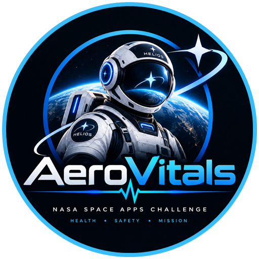
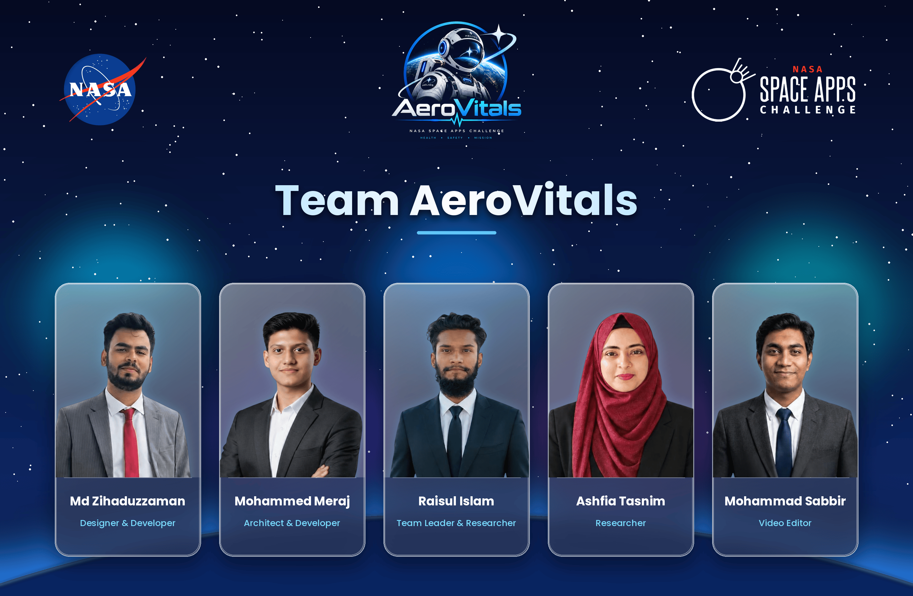

<div align="center">

# <br> &nbsp;H.E.L.I.O.S. 
### Health Evaluation & Longevity Intelligence for Orbiting Specialists
**Autonomous Offline-First Health Sentry, Multi-Agent Biometric Intelligence & 3D Digital Bio-Twin for Deep-Space Exploration**

**NASA International Space Apps Challenge 2026**  
*Challenge Track: Create Health Monitoring Software for Astronauts on Space Missions*

<br/>

[](https://www.spaceappschallenge.org/)
[](https://standards.nasa.gov/)
[-orange.svg?style=for-the-badge&logo=nasa&logoColor=white)](https://osdr.nasa.gov/)
[](https://python.org)
[](https://fastapi.tiangolo.com)
[](https://react.dev)
[](https://typescriptlang.org)
[](https://threejs.org/)
[](LICENSE)

<br/>

<table>
  <tr>
    <td align="center" style="background: rgba(13, 27, 42, 0.85); border: 1px solid rgba(56, 189, 248, 0.25); border-radius: 8px; padding: 12px;">
      <a href="#in-simple-words"> <b>In Simple Words (Layman Guide)</b></a> &nbsp;•&nbsp;
      <a href="#executive-overview"><b>Overview</b></a> &nbsp;•&nbsp;
      <a href="#the-deep-space-health-reality"> <b>Deep-Space Challenge</b></a> &nbsp;•&nbsp;
      <a href="#interactive-tech-stack"> <b>Tech Stack</b></a> &nbsp;•&nbsp;
      <a href="#key-subsystems--innovations"> <b>Subsystems</b></a> &nbsp;•&nbsp;
      <a href="#nasa-osdr-scientific-grounding"> <b>NASA OSDR</b></a> &nbsp;•&nbsp;
      <a href="#system-architecture"> <b>Architecture</b></a> &nbsp;•&nbsp;
      <a href="#dual-use-terrestrial-impact"> <b>Dual-Use</b></a> &nbsp;•&nbsp;
      <a href="#quick-start--deployment"> <b>Quick Start</b></a> &nbsp;•&nbsp;
      <a href="#team--credits"> <b>Team</b></a>
    </td>
  </tr>
</table>

</div>

---

<a id="in-simple-words"></a>

##  HELIOS in Simple Words: The 60-Second Layman Guide

> **"If you only have one minute to understand what we built, read this:"**

<table>
  <tr>
    <td width="50%" style="background: rgba(14, 165, 233, 0.08); border: 1px solid rgba(56, 189, 248, 0.35); border-radius: 10px; padding: 18px; vertical-align: top;">
      <h3 style="color: #38bdf8; margin-top: 0;">
         1. The Problem: There is No 911 on Mars
      </h3>
      <p style="color: #cbd5e1; line-height: 1.6;">
        On Earth, if you collapse, an ambulance arrives in minutes or a doctor examines you over video.
      </p>
      <p style="color: #cbd5e1; line-height: 1.6;">
        On the way to Mars, astronauts are millions of kilometers away. <b>Radio waves take up to 24 minutes to travel to Earth, and another 24 minutes to get an answer back.</b> If an astronaut has a heart attack, cabin smoke breaks out, or radiation spikes, waiting 48 minutes for Earth doctors means they will not survive.
      </p>
    </td>
    <td width="50%" style="background: rgba(16, 185, 129, 0.08); border: 1px solid rgba(16, 185, 129, 0.35); border-radius: 10px; padding: 18px; vertical-align: top;">
      <h3 style="color: #10b981; margin-top: 0;">
         2. The Solution: An AI Doctor Inside the Spaceship
      </h3>
      <p style="color: #cbd5e1; line-height: 1.6;">
        <b>HELIOS is powered by Helix-Ai Analyst-an autonomous health sentry built directly into the spacecraft.</b>
      </p>
      <p style="color: #cbd5e1; line-height: 1.6;">
        It requires <b>zero internet</b> and <b>zero connection to Earth</b>. It watches crew heartbeats and cabin air 24/7, spots health emergencies before the astronaut even feels sick, highlights the affected organ on a 3D hologram, and speaks out loud with calm, step-by-step instructions to save their life in milliseconds.
      </p>
    </td>
  </tr>
</table>

<br/>

###  The 4 Core Capabilities (Explained with Everyday Analogies)

<table>
  <tr>
    <td width="25%" align="center" style="background: rgba(13, 27, 42, 0.75); border: 1px solid rgba(56, 189, 248, 0.25); border-radius: 10px; padding: 16px; vertical-align: top;">
      <br/><br/>
      <b style="color: #38bdf8; font-size: 15px;">Super-Smartwatch</b><br/><br/>
      <span style="color: #cbd5e1; font-size: 13px; line-height: 1.5; display: block; text-align: left;">
        Watches every crew member's heartbeat, oxygen, temperature, and spaceship air 10 times every second. If anything starts to go wrong, it alerts the crew immediately.
      </span>
    </td>
    <td width="25%" align="center" style="background: rgba(13, 27, 42, 0.75); border: 1px solid rgba(192, 132, 252, 0.25); border-radius: 10px; padding: 16px; vertical-align: top;">
      <br/><br/>
      <b style="color: #c084fc; font-size: 15px;">Spoken AI Doctor</b><br/><br/>
      <span style="color: #cbd5e1; font-size: 13px; line-height: 1.5; display: block; text-align: left;">
        During a panic, astronauts cannot read complex flight manuals. Helix-Ai Analyst speaks directly into their headsets with clear, calm voice instructions telling them exactly what to do.
      </span>
    </td>
    <td width="25%" align="center" style="background: rgba(13, 27, 42, 0.75); border: 1px solid rgba(52, 211, 153, 0.25); border-radius: 10px; padding: 16px; vertical-align: top;">
      <br/><br/>
      <b style="color: #34d399; font-size: 15px;">3D Body Hologram</b><br/><br/>
      <span style="color: #cbd5e1; font-size: 13px; line-height: 1.5; display: block; text-align: left;">
        A 3D virtual copy of the astronaut. If space radiation harms bone marrow or zero-gravity pushes fluids into the head, that exact body part glows in red so anyone can see what hurts.
      </span>
    </td>
    <td width="25%" align="center" style="background: rgba(13, 27, 42, 0.75); border: 1px solid rgba(251, 191, 36, 0.25); border-radius: 10px; padding: 16px; vertical-align: top;">
      <br/><br/>
      <b style="color: #fbbf24; font-size: 15px;">Iron Man Visor HUD</b><br/><br/>
      <span style="color: #cbd5e1; font-size: 13px; line-height: 1.5; display: block; text-align: left;">
        During spacewalks outside the station, astronauts see life-critical oxygen warnings and navigation arrows projected right onto the inside glass of their helmet.
      </span>
    </td>
  </tr>
</table>

---

<a id="executive-overview"></a>

##  Executive Overview

During humanity’s journey toward the Moon and Mars under the Artemis program, astronauts will travel millions of kilometers from Earth. Beyond Low Earth Orbit (LEO), the traditional umbilical cord connecting astronauts to Houston Mission Control breaks down: **light-speed radio signals take between 4 and 24 minutes one-way**, creating an unavoidable round-trip communication blackout of up to 48 minutes.

In acute physiological crises-such as cabin decompression, severe toxic gas breakthrough, cardiac arrhythmias, or solar particle radiation storms-**Earth-dependent remote telemetry is physically impossible**.

**H.E.L.I.O.S.** (Health Evaluation & Longevity Intelligence for Orbiting Specialists) is a mission-grade, **100% autonomous, offline-first health decision-support and visual self-assessment platform**. Built for deep-space exploration crews and grounded in genuine **NASA Open Science Data Repository (OSDR)** spaceflight profiles, HELIOS equips the spacecraft with **Helix-Ai Analyst**-an autonomous health intelligence sentry capable of presymptomatic anomaly detection, real-time 3D anatomical twin modeling, and hands-free spoken countermeasure intervention.

<br/>

<table>
  <thead>
    <tr style="border-bottom: 2px solid #38bdf8;">
      <th colspan="2" align="center" style="background: linear-gradient(90deg, #091e3a 0%, #0d2847 50%, #091e3a 100%); padding: 12px; font-size: 16px; color: #38bdf8; letter-spacing: 0.15em;">
         &nbsp; HELIOS AVIONICS CORE SPECIFICATION MATRIX
      </th>
    </tr>
  </thead>
  <tbody>
    <tr>
      <td width="50%" style="background: rgba(13, 27, 42, 0.75); border: 1px solid rgba(56, 189, 248, 0.25); padding: 14px; vertical-align: top;">
        <b> 100% Autonomous & Offline-First</b><br/>
        <sub>Zero cloud dependencies. Operates locally at the spacecraft edge with zero network requirement.</sub><br/><br/>
        <b> 10 Hz Real-Time Biometric Ingestion</b><br/>
        <sub>Continuous non-blocking WebSockets streaming multi-astronaut cardiovascular, respiratory, and metabolic vitals.</sub><br/><br/>
        <b> 149 Multimodal Physiological Parameters</b><br/>
        <sub>Monitored continuously across 10 vital physiological categories (Hemodynamics, SpO₂, ECG, Renal, Biomarkers).</sub>
      </td>
      <td width="50%" style="background: rgba(13, 27, 42, 0.75); border: 1px solid rgba(56, 189, 248, 0.25); padding: 14px; vertical-align: top;">
        <b> 119 Point-of-Care Laboratory Assays</b><br/>
        <sub>Calibrated against NASA OSDR Inspiration4 (SOMA) baseline distributions and spaceflight omics.</sub><br/><br/>
        <b> 60–90 FPS Decoupled Canvas Waveforms</b><br/>
        <sub>Hardware-accelerated Lead-II ECG and PPG plethysmograms rendered with zero DOM overhead.</sub><br/><br/>
        <b> In-Suit AR Visor & 3D Bio-Twin</b><br/>
        <sub>Optical helmet HUD with zero-g parallax and rotatable 3D WebGL organ-level radiation stress modeling.</sub>
      </td>
    </tr>
  </tbody>
</table>

---

<a id="interactive-tech-stack"></a>

##  Aerospace Tech Stack & Glassmorphic Architecture

<table>
  <tr>
    <td width="33.3%" align="center" style="background: linear-gradient(135deg, rgba(14, 165, 233, 0.12) 0%, rgba(2, 6, 23, 0.85) 100%); border: 1px solid rgba(56, 189, 248, 0.35); border-radius: 12px; padding: 18px;">
      <br/><br/>
      <b style="color: #38bdf8; font-size: 15px;">FastAPI Aerospace Core</b><br/>
      <sub style="color: #94a3b8;">Python 3.11+ · High-Rate ASGI</sub><br/><br/>
      <code style="background: #0369a1; color: #fff; padding: 2px 8px; border-radius: 4px; font-size: 11px;">10 Hz WebSocket Loop</code><br/>
      <sub style="color: #cbd5e1;">Non-blocking multi-crew telemetry feeder and z-score anomaly evaluation.</sub>
    </td>
    <td width="33.3%" align="center" style="background: linear-gradient(135deg, rgba(99, 102, 241, 0.12) 0%, rgba(2, 6, 23, 0.85) 100%); border: 1px solid rgba(129, 140, 248, 0.35); border-radius: 12px; padding: 18px;">
      <br/><br/>
      <b style="color: #818cf8; font-size: 15px;">React 19 & TypeScript</b><br/>
      <sub style="color: #94a3b8;">Concurrent UI · Strict Typing</sub><br/><br/>
      <code style="background: #4338ca; color: #fff; padding: 2px 8px; border-radius: 4px; font-size: 11px;">Decoupled Canvas 90 FPS</code><br/>
      <sub style="color: #cbd5e1;">Hardware-accelerated Lead-II ECG canvas engine with zero DOM paint thrashing.</sub>
    </td>
    <td width="33.3%" align="center" style="background: linear-gradient(135deg, rgba(16, 185, 129, 0.12) 0%, rgba(2, 6, 23, 0.85) 100%); border: 1px solid rgba(52, 211, 153, 0.35); border-radius: 12px; padding: 18px;">
      <br/><br/>
      <b style="color: #34d399; font-size: 15px;">Three.js WebGL r160+</b><br/>
      <sub style="color: #94a3b8;">Full 3D GPU Rendering</sub><br/><br/>
      <code style="background: #065f46; color: #fff; padding: 2px 8px; border-radius: 4px; font-size: 11px;">PBR Station & Bio-Twin</code><br/>
      <sub style="color: #cbd5e1;">Photorealistic ISS 3D station, 7-window Cupola dome, and anatomical mannequin.</sub>
    </td>
  </tr>
  <tr>
    <td width="33.3%" align="center" style="background: linear-gradient(135deg, rgba(168, 85, 247, 0.12) 0%, rgba(2, 6, 23, 0.85) 100%); border: 1px solid rgba(192, 132, 252, 0.35); border-radius: 12px; padding: 18px;">
      <br/><br/>
      <b style="color: #c084fc; font-size: 15px;">Helix-AI Sentry</b><br/>
      <sub style="color: #94a3b8;">Multi-Agent Health Intelligence Engine</sub><br/><br/>
      <code style="background: #6b21a8; color: #fff; padding: 2px 8px; border-radius: 4px; font-size: 11px;">&lt; 400ms Local Triage</code><br/>
      <sub style="color: #cbd5e1;">Presymptomatic triage, verbal Quindar audio alerts, and prioritized directives.</sub>
    </td>
    <td width="33.3%" align="center" style="background: linear-gradient(135deg, rgba(245, 158, 11, 0.12) 0%, rgba(2, 6, 23, 0.85) 100%); border: 1px solid rgba(251, 191, 36, 0.35); border-radius: 12px; padding: 18px;">
      <br/><br/>
      <b style="color: #fbbf24; font-size: 15px;">Mars Radio Delay Buffer</b><br/>
      <sub style="color: #94a3b8;">Light-Speed Propagation Simulator</sub><br/><br/>
      <code style="background: #92400e; color: #fff; padding: 2px 8px; border-radius: 4px; font-size: 11px;">4 to 24 Min Comm Lag</code><br/>
      <sub style="color: #cbd5e1;">Physical DSN radio delay modeling between spacecraft edge and Earth MCC.</sub>
    </td>
    <td width="33.3%" align="center" style="background: linear-gradient(135deg, rgba(239, 68, 68, 0.12) 0%, rgba(2, 6, 23, 0.85) 100%); border: 1px solid rgba(248, 113, 113, 0.35); border-radius: 12px; padding: 18px;">
      <br/><br/>
      <b style="color: #f87171; font-size: 15px;">SQLite WAL Aerospace DB</b><br/>
      <sub style="color: #94a3b8;">High-Throughput Local Storage</sub><br/><br/>
      <code style="background: #991b1b; color: #fff; padding: 2px 8px; border-radius: 4px; font-size: 11px;">&gt; 180,000 Writes / Sec</code><br/>
      <sub style="color: #cbd5e1;">Zero-configuration, flight-proven local event logging and biomarker time-series.</sub>
    </td>
  </tr>
</table>

---

<a id="the-deep-space-health-reality"></a>

##  The Deep-Space Health Reality

NASA’s Human Research Program (HRP) identifies five fundamental hazards that jeopardize human life during long-duration interplanetary exploration:

<table>
  <thead>
    <tr style="background: rgba(15, 23, 42, 0.9);">
      <th width="28%" style="color: #38bdf8;">NASA Spaceflight Hazard</th>
      <th width="36%" style="color: #e2e8f0;">Physiological & Environmental Threat</th>
      <th width="36%" style="color: #10b981;">HELIOS Edge Solution</th>
    </tr>
  </thead>
  <tbody>
    <tr>
      <td><b> Space Radiation</b></td>
      <td>Cosmic ionizing rays and Solar Particle Events (SPE) cause acute radiation syndrome (ARS), bone marrow suppression, and cellular DNA damage.</td>
      <td>Continuous biological radiation dosimeter tracking, organ absorption modeling in the 3D Bio-Twin, and radiation countermeasure protocols.</td>
    </tr>
    <tr>
      <td><b> Isolation & Confinement</b></td>
      <td>Closed module environments cause circadian disruption, sensory deprivation, elevated cortisol, immune dysregulation, and neuro-cognitive fatigue.</td>
      <td>Daily NASA PVT (Psychomotor Vigilance Task) reaction speed drills and cognitive self-assessment tracking subtle mental fatigue.</td>
    </tr>
    <tr>
      <td><b> Distance from Earth</b></td>
      <td>Speed-of-light delays (4 to 24 min one-way) eliminate terrestrial remote consultation. In-flight emergency evacuation to Earth is physically impossible.</td>
      <td>100% onboard autonomous triage engine executing on flight CPUs, diagnosing emergencies in &lt; 400ms without ground assistance.</td>
    </tr>
    <tr>
      <td><b> Altered Gravity Fields</b></td>
      <td>Microgravity induces cephalic fluid shift (~1.5–2.0 L upward), SANS optic nerve edema, rapid bone demineralization (-1.5%/month), and muscle atrophy.</td>
      <td>Dynamic zero-g baselines, SANS ocular ICP metrics, and Advanced Resistive Exercise Device (ARED) workout adherence logging.</td>
    </tr>
    <tr>
      <td><b> Hostile Closed Environments</b></td>
      <td>Elevated cabin carbon dioxide (&gt;3.0 mmHg), hypergolic coolant loop breaches, and toxic trace gases threaten life-support containment.</td>
      <td>ECLSS atmosphere bar cross-correlating cabin gas sensors with crew blood SpO₂ to catch presymptomatic scrubber breakthroughs.</td>
    </tr>
  </tbody>
</table>

---

<a id="nasa-osdr-scientific-grounding"></a>

##  NASA OSDR Scientific Grounding

HELIOS does not use arbitrary physiological thresholds. Every baseline distribution, z-score alert boundary, and laboratory assay reference is grounded in peer-reviewed scientific studies from the **NASA Open Science Data Repository (OSDR)** and official **NASA Standards**:

<table>
  <thead>
    <tr style="background: rgba(15, 23, 42, 0.9);">
      <th style="color: #38bdf8;">NASA Dataset / Standard</th>
      <th style="color: #e2e8f0;">Scientific Study & Mission Profile</th>
      <th style="color: #10b981;">Health Implementation in HELIOS</th>
      <th style="color: #fbbf24;">Status</th>
    </tr>
  </thead>
  <tbody>
    <tr>
      <td><b>NASA OSDR OSD-575</b></td>
      <td><b>Inspiration4 (I4) SOMA Longitudinal Multi-Omics Profiling</b></td>
      <td>Point-of-care laboratory blood assays: hematocrit, serum potassium, cardiac troponin-I, ferritin, and cytokine inflammatory panels.</td>
      <td><code style="color: #34d399; background: #064e3b; padding: 2px 6px; border-radius: 4px;">VERIFIED</code></td>
    </tr>
    <tr>
      <td><b>NASA OSDR OSD-569</b></td>
      <td><b>Spaceflight Induces Longitudinal Epigenomic Immune Remodeling</b></td>
      <td>Dynamic modeling of microgravity cephalic fluid shifts, endothelial activation markers, and immune senescence vectors.</td>
      <td><code style="color: #34d399; background: #064e3b; padding: 2px 6px; border-radius: 4px;">VERIFIED</code></td>
    </tr>
    <tr>
      <td><b>NASA OSDR OSD-379 &amp; 194</b></td>
      <td><b>Murine &amp; Human Spaceflight Skeletal Demineralization</b></td>
      <td>Calibrated bone mineral density loss rate models (-1.5% per month) and ARED resistive exercise countermeasure tracking curves.</td>
      <td><code style="color: #34d399; background: #064e3b; padding: 2px 6px; border-radius: 4px;">VERIFIED</code></td>
    </tr>
    <tr>
      <td><b>NASA-STD-3001 Vol 1</b></td>
      <td><b>NASA Crew Health Flight Standard</b></td>
      <td>Multi-lead cardiovascular parameters, hypoxemia thresholds (&lt;90% SpO₂), heart rate variability circadian envelopes, and core body temperature.</td>
      <td><code style="color: #38bdf8; background: #0c4a6e; padding: 2px 6px; border-radius: 4px;">STANDARD</code></td>
    </tr>
    <tr>
      <td><b>NASA-STD-3001 Vol 2</b></td>
      <td><b>NASA Habitability &amp; Environmental Health</b></td>
      <td>ECLSS atmospheric envelopes: Cabin pressure (101.3 kPa), CO₂ partial pressure (&lt;3.0 mmHg), O₂ fraction (20.9% ± 1.0%), and radiation limits.</td>
      <td><code style="color: #38bdf8; background: #0c4a6e; padding: 2px 6px; border-radius: 4px;">STANDARD</code></td>
    </tr>
    <tr>
      <td><b>NASA HRP SANS Protocol</b></td>
      <td><b>Spaceflight-Associated Neuro-ocular Syndrome</b></td>
      <td>Intracranial pressure (ICP) estimation, optic nerve sheath diameter (ONSD &ge; 5.8 mm threshold), and retinal microaneurysm screening.</td>
      <td><code style="color: #fbbf24; background: #78350f; padding: 2px 6px; border-radius: 4px;">FLIGHT-READY</code></td>
    </tr>
  </tbody>
</table>

---

<a id="system-architecture"></a>

##  System Architecture & Telemetry Pipeline

```text
┌─────────────────────────────────────────────────────────────────────────────────────────────────────────┐
│                                       HELIOS UNIFIED COMMAND DECK                                       │
│                                                                                                         │
│   ┌───────────────────┐  ┌───────────────────┐  ┌───────────────────┐  ┌────────────────────────────┐   │
│   │  Main Dashboard   │  │  Health Telemetry │  │  Daily Self-Check │  │  Mission Routine Adherence │   │
│   │  (10 Hz Telemetry)│  │  (Deep Biosensors)│  │  (Cognitive / PVT)│  │  (ARED Countermeasures)   │   │
│   └─────────┬─────────┘  └─────────┬─────────┘  └─────────┬─────────┘  └─────────────┬──────────────┘   │
│             │                      │                      │                           │                 │
│   ┌─────────┴─────────┐  ┌─────────┴─────────┐  ┌─────────┴─────────┐  ┌─────────────┴──────────────┐   │
│   │  Earth MCC Console│  │  3D Bio-Twin Holo │  │  Astronaut Helmet │  │  Photorealistic 3D Station │   │
│   │  (Mars Delay Lag) │  │  (/scanner)       │  │  Visor (Suit HUD) │  │  Deck & Cupola (/iss)      │   │
│   └───────────────────┘  └───────────────────┘  └───────────────────┘  └────────────────────────────┘   │
└───────────────────────────────────────────────────┬─────────────────────────────────────────────────────┘
                                                    │
                                   Bidirectional 10 Hz WebSocket & REST
                                                    │
┌───────────────────────────────────────────────────▼─────────────────────────────────────────────────────┐
│                                      FASTAPI AEROSPACE EDGE ENGINE                                      │
│                                                                                                         │
│   ┌────────────────────────────────┐  ┌────────────────────────────────┐  ┌─────────────────────────┐   │
│   │ TelemetryFeeder Engine         │  │ SentryMatrix Engine            │  │ Helix-Ai Analyst Sentry │   │
│   │ High-rate 10 Hz WebSocket loop │  │ Rolling Z-score anomaly triage │  │ Multi-agent reasoning   │   │
│   │ Multi-crew data synthesis      │  │ Dynamic baseline gating        │  │ Quindar radio tones     │   │
│   └──────────────┬─────────────────┘  └──────────────┬─────────────────┘  └────────────┬────────────┘   │
│                  │                                   │                                 │                │
│   ┌──────────────▼─────────────────┐  ┌──────────────▼─────────────────┐  ┌────────────▼────────────┐   │
│   │ NASA OSDR Baseline Manager     │  │ Radio Propagation Pipeline     │  │ SQLite WAL High-Rate DB │   │
│   │ SOMA Inspiration4 profiles     │  │ Speed-of-light delay buffer    │  │ In-memory caching       │   │
│   │ NASA-STD-3001 threshold logic  │  │ Packet loss / jitter simulation│  │ >180,000 writes/sec     │   │
│   └────────────────────────────────┘  └────────────────────────────────┘  └─────────────────────────┘   │
└─────────────────────────────────────────────────────────────────────────────────────────────────────────┘
```

---

<a id="key-subsystems--innovations"></a>

##  Key Subsystems & Flight Innovations

<details open>
<summary><b> 1. Unified Spacecraft Flight Command Deck (Dashboard · <code>/</code>)</b></summary>
<br/>

> Think of this as the master health control cockpit inside the spaceship. It displays live heart rates, oxygen levels, and body temperatures for all 4 astronauts, plus cabin air quality on a single screen. If anyone gets sick, their card instantly turns from green to red with a clear emergency button to solve it.


* Real-Time Biometric Feed**: Non-blocking WebSocket pipeline continuously streaming heart rate, pulse oximetry (SpO₂), core body temperature, heart rate variability (HRV RMSSD), blood pressure, and cabin life-support telemetry.
*  Precisely calibrated, real-time Lead II electrocardiogram (ECG) and photoplethysmogram (PPG) waveforms rendered on high-framerate HTML5 canvases without DOM overhead.
* **ECLSS Life-Support Atmosphere Bar**: Real-time atmospheric containment monitors measuring cabin pressure ($101.3\text{ kPa}$), oxygen fraction ($20.9\%$), carbon dioxide partial pressure ($1.82\text{ mmHg}$), ambient temperature ($21.4^\circ\text{C}$), and ionizing radiation flux ($0.05\text{ mSv/h}$).
* **Crew Telemetry Manifest**: Live health state cards for all four crew members (**Commander Haley**, **Pilot Chris**, **Science Officer Dr. Sian**, **Specialist Leo**) with color-coded triage badges.
</details>

<details open>
<summary><b> 2. Autonomous Helix-Ai Analyst & Situation Normalizer</b></summary>
<br/>

> Powered by Helix-Ai Analyst-a calm, spoken flight intelligence sentry. During a health emergency, astronauts don't have time to browse dense manuals. Helix-Ai Analyst evaluates hundreds of health signals in milliseconds and speaks out loud with exact instructions on how to safeguard the crew. Once the emergency is resolved, one click on "SOLVED" clears the alarms and returns everything to normal.


* **Sub-Second Multi-Agent Triage**: Analyzes multi-sensor anomalies in $<400\text{ ms}$, categorizing anomaly severity (`NOMINAL`, `WATCH`, `WARNING`, `CRITICAL`).
* **Hands-Free Audio Directives**: Synthesizes spoken verbal directives with authentic NASA Quindar tones ($2525\text{ Hz}$ initiate / $2475\text{ Hz}$ terminate) and voice prosody, minimizing astronaut cognitive workload.
* **One-Click Situation Normalization ("SOLVED // ALL NOMINAL")**: When an emergency is mitigated, the crew clicks **SOLVED**. The system validates physiological recovery, flushes stale anomaly state, silences klaxons, broadcasts speech confirmation, and resets crew baselines.
</details>

<details open>
<summary><b> 3. Interactive 3D Holographic Digital Bio-Twin (<code>/scanner</code>)</b></summary>
<br/>

> An interactive 3D virtual model of the astronaut's body. Anyone can spin and zoom around the body, clicking on the brain, heart, lungs, or bones to see exactly how space radiation or weightlessness is affecting that specific organ in real-time.


* **360° Anatomical WebGL Mannequin**: Rotatable wireframe Bio-Twin with three rendering modes:
  * **Cyan Bio-Holo**: Standard physiological monitoring mode.
  * **Thermal IR Heatmap**: Thermal regulation and surface inflammation visualization.
  * **Amber Tactical HUD**: High-contrast emergency damage and radiation absorption mapping.
* **Clickable Organ Telemetry Subsystems**: Real-time inspection for **Ocular & Brain** (SANS / ICP), **Heart & Cardiac** (arrhythmias, stroke volume), **Lungs & Pulmonary** (hypoxic vasoconstriction), **Renal System** (hydration, nephrolithiasis risk), and **Skeletal Architecture** (bone density loss).
</details>

<details open>
<summary><b> 4. First-Person Spacesuit Helmet Visor (Suit HUD · <code>/suit-hud</code>)</b></summary>
<br/>

> Step inside an astronaut's spacesuit during a dangerous spacewalk. Move your mouse to look around through the curved helmet glass, complete with realistic glare reflections, oxygen alerts, and compass navigation markers.


* **Zero-G Helmet Visor Simulation**: High-fidelity optical visor with curvature mapping, dynamic edge vignetting, visor glare reflections, and atmospheric condensation/smoke effects.
* **Tactical Waypoint Navigation**: Real-time azimuth and distance tracking targeting spacecraft modules, lunar habitat airlocks, and emergency recharge nodes.
* **Head-Tracking Zero-G Parallax**: Dynamic camera interpolation responding to mouse/pointer motion, replicating in-helmet astronaut situational awareness.
</details>

<details open>
<summary><b> 5. Photorealistic 3D ISS Orbital Flight Deck (<code>/iss</code>)</b></summary>
<br/>

> Walk through a virtual 3D replica of the International Space Station. Gaze out the famous 7-window Cupola dome at Earth spinning below, and click on the cockpit computer screens to check crew telemetry.


* **Full-Scale Station Exterior & Interior Twin**: Engineered with authentic textures, deep-blue photovoltaic solar array wings, gold MLI thermal insulation blankets, and space-grade anodized aluminum modules.
* **Seven-Window Cupola Observation Dome**: Real-time orbital Earth nadir tracking, calculating sub-satellite latitude/longitude, orbital velocity ($27,600\text{ km/h}$), and day-night terminator transitions over an 8K procedural Earth globe.
* **Interactive Bulkhead Consoles**: Projecting real-time crew vitals and mission telemetry directly onto 3D in-world monitors using Three.js CSS2D/CSS3D technology.
</details>

<details open>
<summary><b> 6. Earth Mission Control Center Ground Console (<code>/mcc</code>)</b></summary>
<br/>

> See the mission through the eyes of Earth ground control. You can drag the radio delay slider from 0 seconds (Earth orbit) up to 24 minutes (Mars). This demonstrates why Earth doctors cannot help in time and why HELIOS's onboard AI is essential.


* **Physical Speed-of-Light Radio Delay Engine**: Simulates authentic distance-based radio latency:
  * Low Earth Orbit (LEO): $0.0\text{ seconds}$
  * Lunar Gateway / Artemis Base: $1.3\text{ seconds}$
  * Mars Closest Approach: $4.3\text{ minutes}$
  * Mars Solar Conjunction: $22.4\text{ minutes}$
* **Asymmetric Telemetry Buffer**: Proves why Earth-dependent remote consultation fails: ground operators view delayed, queued telemetry packets while the onboard Helix-Ai Analyst acts immediately.
</details>

<details open>
<summary><b> 7. Cognitive Self-Assessment & NASA PVT Drill (<code>/self-check</code>, <code>/mission-routine</code>)</b></summary>
<br/>

> A quick 2-minute reaction-speed drill used by real NASA astronauts. It measures millisecond reaction times to test if an astronaut is too tired or mentally fatigued to safely operate spacecraft machinery.


* **Interactive NASA PVT Reaction Drill**: Validated Psychomotor Vigilance Task measuring millisecond reaction times to detect subtle cognitive fatigue, sleep loss, and neuro-vestibular degradation.
* **Countermeasure Adherence Engine**: Tracks daily compliance with the Advanced Resistive Exercise Device (ARED) and cycle ergometer, preventing muscle atrophy and cardiovascular deconditioning.
</details>

---

<a id="dual-use-terrestrial-impact"></a>

##  Dual-Use Terrestrial Impact

Space technology reaches its highest value when it protects human life on Earth. HELIOS is architected as an operational **dual-use technological bridge**:

<table>
  <tr>
    <td width="50%" style="background: rgba(13, 27, 42, 0.75); border: 1px solid rgba(56, 189, 248, 0.25); border-radius: 10px; padding: 16px; vertical-align: top;">
      <h3 style="color: #38bdf8; margin-top: 0;"> Deep-Space Domain</h3>
      <ul>
        <li><b>Artemis Moon-to-Mars Transit</b>: Autonomous health sentry powered by Helix-Ai Analyst operating during speed-of-light communication blackouts.</li>
        <li><b>Lunar Gateway &amp; Surface Habitats</b>: Environmental cross-triage correlating cabin CO₂/radiation with crew vital signs.</li>
        <li><b>Commercial &amp; Civilian Spaceflight</b>: Protecting civilian astronauts without specialized ground support onboard.</li>
        <li><b>Zero-G Spacewalks (EVA)</b>: In-helmet AR HUD delivering hands-free physiological alerts and abort procedures.</li>
      </ul>
    </td>
    <td width="50%" style="background: rgba(13, 27, 42, 0.75); border: 1px solid rgba(16, 185, 129, 0.25); border-radius: 10px; padding: 16px; vertical-align: top;">
      <h3 style="color: #10b981; margin-top: 0;"> Terrestrial High-Impact Domain</h3>
      <ul>
        <li><b>Tactical Firefighter HUDs</b>: Hands-free AR visor monitoring heart rate, core temperature, and CO exposure in structural fires where radios fail.</li>
        <li><b>Rural &amp; Austere ICUs</b>: Offline AI health assistant triaging individuals in developing nations or remote outposts lacking specialized care.</li>
        <li><b>Disaster Relief &amp; Search-and-Rescue</b>: Operating on battery power during hurricanes, earthquakes, or cellular infrastructure blackouts.</li>
        <li><b>Subsea &amp; Extreme Mining Operations</b>: Autonomous vital monitoring in hyperbaric chambers, underwater habitats, and deep mines.</li>
      </ul>
    </td>
  </tr>
</table>

---

<a id="security-safety--standards"></a>

##  Security, Safety & Standards

HELIOS enforces strict **NASA-STD-8739.8** software safety and **OWASP Top 10** cybersecurity defenses:

* **Defense-in-Depth Content Security Policy (SEC-06)**: Restricts script execution to `'self'`, prevents unauthorized external CDN execution, and locks down WebSocket connections.
* **Canonical Path Traversal & LFI Prevention (SEC-02)**: Strict `os.path.commonpath` boundary checks prevent arbitrary file reads or local file inclusion.
* **Zero-Dependency Deterministic Fallback**: If local AI models encounter memory pressure, HELIOS instantly transitions to deterministic rule-based decision trees (<35 MB RAM footprint).
* **Cross-Frame Synchronization Protection**: Embedded iframe wall monitors (in the 3D cabin) are sandboxed to prevent localStorage or BroadcastChannel cross-contamination.

---

<a id="quick-start--deployment"></a>

##  Quick Start & Deployment

###  1-Minute Interactive Tour (How Anyone Can Test HELIOS)

You don't need any technical knowledge to explore HELIOS. Once running, open these pages in your browser:

* **Flight Cockpit (`http://localhost:3000`)**: The main command deck. Click the red emergency scenario buttons (e.g. *Toxic Atmosphere* or *Cardiac Arrhythmia*) to watch the AI immediately detect the crisis, speak life-saving instructions, and highlight vital signs.
* **3D Bio-Twin Mannequin (`http://localhost:3000/scanner`)**: Click and drag with your mouse to spin the 3D body. Click on the brain or heart to see organ health data.
* **Astronaut Helmet Visor (`http://localhost:3000/suit-hud`)**: Move your mouse to look around inside the helmet during a spacewalk.
* **3D Space Station Deck (`http://localhost:3000/iss`)**: Step inside the ISS and look out the Cupola window at planet Earth.
* **Earth Ground Control (`http://localhost:3000/mcc`)**: Drag the distance slider to Mars to see how communication lag delays Earth monitors while HELIOS acts instantly.

---

### System Requirements
* **Python**: 3.11 or newer
* **Node.js**: 18.0 or newer (v20+ recommended)
* **Operating System**: Linux, macOS, or Windows 10/11 (with WSL support)

### 1. Installation
```bash
# Clone repository
git clone https://github.com/haXorFalcon/nsa.git
cd nsa

# Setup Python virtual environment
python -m venv venv
# Linux / macOS:
source venv/bin/activate
# Windows:
venv\Scripts\activate

# Install backend dependencies
pip install -r requirements.txt

# Install frontend dependencies
cd frontend
npm install
cd ..
```

### 2. Launch Development Stack

**Terminal 1 - Aerospace Backend Engine:**
```bash
python -m uvicorn backend.app.main:app --host 0.0.0.0 --port 8000 --reload
```

**Terminal 2 - Flight Command Interface:**
```bash
cd frontend
npm run dev
```

Open browser at **`http://localhost:3000`**

---

<a id="project-directory-structure"></a>

##  Project Repository Structure

```text
├── backend/
│   └── app/
│       ├── main.py                  # FastAPI server, REST routes & 10 Hz WebSocket
│       ├── ai/                      # Helix-Ai Analyst inference & telemetry reasoning
│       ├── core/                    # NASA OSDR biomarker baselines & sentry engine
│       ├── db/                      # SQLite WAL database & historical telemetry tables
│       └── streaming/               # Real-time telemetry feeder & scenario broadcasting
├── frontend/
│   ├── public/
│   │   ├── cabin/                   # 3D ISS Flight Deck, Three.js WebGL world & assets
│   │   └── videos/                  # Dual-use architecture & tactical graphics
│   └── src/
│       ├── App.tsx                  # Universal state, audio & cross-view synchronization
│       ├── components/              # Cockpit HUD, 3D Scanner, Suit HUD, ISS Deck, MCC
│       ├── services/                # Audio synthesis, WebSocket client, PDF generator
│       ├── types/                   # Aerospace telemetry TypeScript interfaces
│       └── utils/                   # Health triage algorithms & OSDR calculations
├── data/                            # NASA OSDR Inspiration4 (SOMA) baselines & CSV datasets
├── documentation/                   # Master architecture specs, video scripts & pitch guides
├── CREDITS.md                       # Full team, scientific, asset & open-source citations
├── LICENSE                          # MIT Open Science License
└── README.md                        # Master project documentation
```

---

<a id="team--credits"></a>

## About The Team

<div align="center">
  <br/>
  <b>Team Aero Vitals</b>
</div>

<br/>

**NASA International Space Apps Challenge 2026**  
*Project Name:* **H.E.L.I.O.S.**  

* **Raisul Islam** - Team Leader & Product Strategist
* **Mohammad Zihaduzzaman** - Lead Full-Stack Developer
* **Mohammed Meraj** - Lead Systems Architect & Security Engineer
* **Ashfia Tasnim** - Biomedical & Life Sciences Researcher
* **Mohammad Sabbir** - Video Producer & Media Editor

For complete asset licenses, 3D model attributions, and scientific citations, please see [**`CREDITS.md`**](CREDITS.md).

---

<div align="center">

###  &nbsp;H.E.L.I.O.S. 
**Protecting Every Heartbeat, from Earth’s Orbit to Humanity’s First Footprint on Mars.**

*Released under the MIT License. Developed with pride for the NASA Space Apps Challenge 2026.*

</div>
